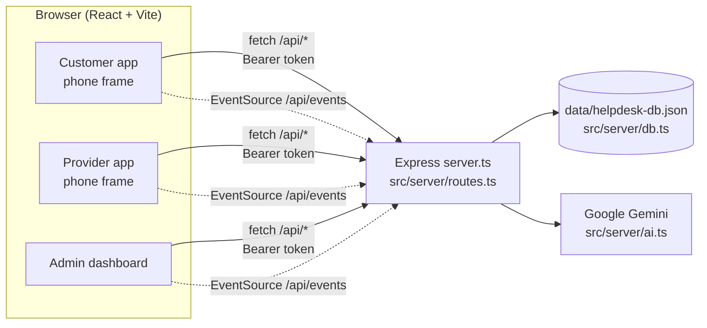
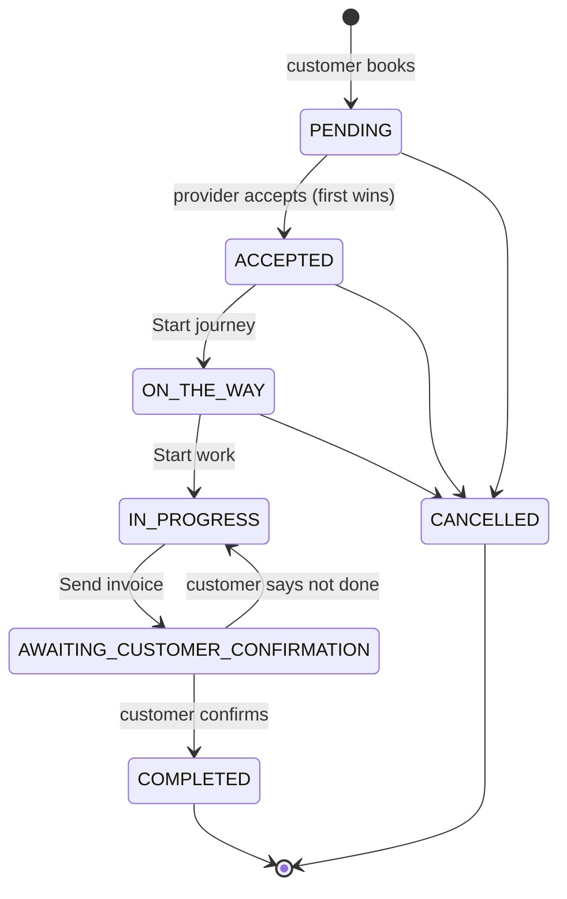

# Architecture

HelpDesk is an on-demand home-services platform for Sri Lanka. One Node process serves the REST API and a React single-page app that simulates the customer mobile app, the provider mobile app and the admin web dashboard.

## Components

| Part | Files | What it does |
| ---- | ----- | ------------ |
| Server entry | `server.ts` | Express app. Mounts the API at `/api`; in development runs Vite as middleware (hot reload), in production serves `dist/`. |
| API | `src/server/routes.ts` | Every endpoint, validation, auth, role checks, notifications and audit log. |
| Database | `src/server/db.ts` | Loads the JSON file into memory, `mutate()` applies a change to a copy and writes it atomically, then notifies live listeners. Also holds the demo seed and password hashing. |
| AI | `src/server/ai.ts` | Problem triage with Gemini (structured JSON output); keyword classifier fallback when no key or on error. |
| Shared types | `src/types/index.ts` | Types and constants (statuses, transitions, categories) used by both the server and the browser. |
| API client | `src/services/api.ts` | Typed `createApiClient()`, `useLiveVersion()` / `useLiveData()` hooks, formatting helpers. |
| Auth | `src/context/AuthContext.tsx` | One `<AuthProvider scope>` per app, so customer, provider and admin can be logged in at once (token per scope in localStorage). |
| UI | `src/components/**` | See [PROJECT_FILES.md](PROJECT_FILES.md). |

## Live sync

Every successful write bumps `db.version`. `/api/events` is a server-sent-events stream that pushes `{ version }` on every change. In the browser one shared `EventSource` feeds `useLiveVersion()`, and `useLiveData(load)` reloads whenever the version changes. That is what makes a booking created in the customer phone appear on the provider's radar immediately, and status changes show on both sides.

The stream carries no data, only a version number, so it needs no auth. Each app then refetches through the authenticated API.

## Auth

- `POST /api/auth/login` / `register` return a token: `base64url(payload).HMAC-SHA256` with a 7-day expiry, signed with `AUTH_SECRET`.
- Passwords are hashed with scrypt and a random salt (`scrypt$salt$hash`).
- `requireAuth` checks the token and that the account is active; `requireRole(...)` checks the role.
- Each app only accepts accounts of its own role (a provider can't log in to the customer app).

## Booking lifecycle

Defined once in `src/types/index.ts` (`BOOKING_STATUS_TRANSITIONS`, `canTransition()`); the server enforces it in `setStatus()`.

- **Open vs direct requests.** Without `requestedProviderId` every approved provider in the category sees the job and the first to accept gets it. With it, only that provider sees it; if they decline it opens to everyone.
- **Atomic accept.** Node handles one request at a time and `mutate()` runs synchronously, so two providers can't both accept.
- **Quotes.** While a job is ACCEPTED/ON_THE_WAY/IN_PROGRESS the provider can send one quote at a time; the customer approves or declines. The invoice uses the last approved quote, otherwise the amount the provider enters.
- **After work starts** cancellation is blocked; problems go through a complaint that an admin resolves.
- Every status change writes a `statusHistory` row and notifies the other party.
- The platform keeps a 10% commission (`PLATFORM_COMMISSION_RATE`), shown in provider earnings and admin revenue.

## Provider verification

`NOT_SUBMITTED` → provider submits NIC, trades, experience → `PENDING_VERIFICATION` → admin approves (`APPROVED`, goes online) or rejects with a note (`REJECTED`, can resubmit). Admins can later `SUSPENDED` an approved provider. Only approved providers appear to customers or receive jobs.

## Live tracking

`LiveServiceTracker` simulates the drive once the provider taps *Start journey*: the marker moves along the route over 90 seconds and the ETA comes from the real distance between the provider's base and the customer's address. To use real GPS, have the provider app post positions and replace `useTravelProgress()`.

## Data and moving to PostgreSQL

The whole database is one JSON document (`Database` in `src/types`). This is fine for a demo on one server, but it is not meant for production: there is one writer process, the whole file is rewritten on each change, and there is no history.

`database/migrations/20261009000001-create-helpdesk-tables.cjs` creates the same schema in PostgreSQL (snake_case columns, `provider_categories` join table) and `database/seeders/20261009000001-seed-demo-data.cjs` loads the JSON file into it. Moving over means replacing `getDb()` / `mutate()` in `src/server/db.ts` with queries. The route handlers and the frontend stay the same.
