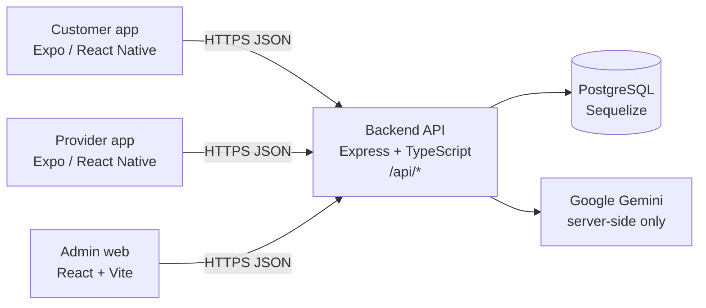
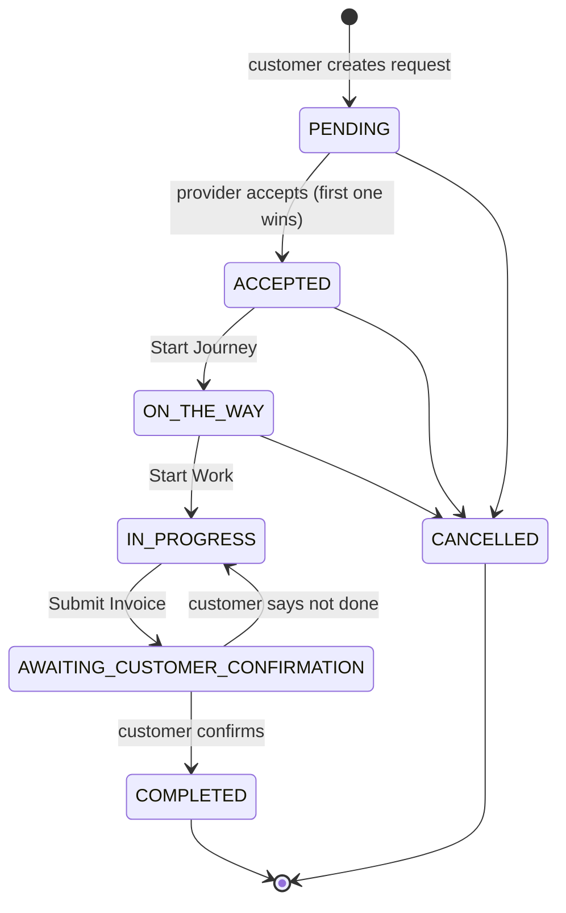

# Architecture

HelpDesk is an on-demand home-services platform for Sri Lanka. Customers book verified tradespeople (plumbers, electricians, AC technicians, …); providers accept and complete jobs; admins verify providers and handle complaints. All prices are in **LKR**.

## Components

| Folder                 | What it is                                                                                                       |
| ---------------------- | ---------------------------------------------------------------------------------------------------------------- |
| `apps/customer-mobile` | Customer app (Expo Router). Browse categories/providers, book, track, chat, review, complain.                    |
| `apps/provider-mobile` | Provider app (Expo Router). Verification, job radar, job workflow, cost proposals, earnings.                     |
| `apps/admin-web`       | Admin dashboard (React, Vite, Tailwind, react-router). Verification queue, bookings, users.                      |
| `backend`              | The single REST API all three apps use. Express, Sequelize (PostgreSQL), JWT, bcrypt, Gemini.                    |
| `packages/shared`      | Types, constants (roles, booking statuses, categories), the fetch-based API client and the React `AuthProvider`. |
| `e2e`                  | Playwright end-to-end tests.                                                                                     |

## API

- Every endpoint is under the **`/api`** prefix, e.g. `GET /api/health` → `{ "ok": true }`.
- Auth: `Authorization: Bearer <JWT>`. `requireAuth` checks the token; `requireRole('ADMIN' | 'PROVIDER' | 'CUSTOMER')` checks the role.
- Each feature is a module in `backend/src/modules/<name>/` with `<name>.routes.ts` → `<name>.controller.ts` (HTTP only) → `<name>.service.ts` (business logic + DB).
- Until a handler is built it returns **501 Not Implemented**.
- Mobile apps read the API URL from `EXPO_PUBLIC_API_URL`; the admin web from `VITE_API_URL`.
- The Gemini API key is only ever on the backend (`GEMINI_API_KEY`). Apps call `/api/ai/*`.

| Module          | Routes                                                                                                                                                                      |
| --------------- | --------------------------------------------------------------------------------------------------------------------------------------------------------------------------- |
| `auth`          | `POST /auth/register`, `POST /auth/login`, `GET /auth/me`, `POST /auth/logout`, `POST /auth/switch-mode`                                                                    |
| `admin`         | `/admin/dashboard`, `/admin/users`, `/admin/users/:id/status`, `/admin/providers/pending`, `/admin/providers/:id/verification`, `/admin/pricing-rules`, `/admin/complaints` |
| `users`         | `/users/me`, `/users/me/addresses`, `/users/me/notification-preferences`, `/users/me/app-settings`, `/users/me/change-password`, `/users/me/account`                        |
| `catalog`       | `GET /categories`, `GET /providers`, `GET /providers/:id`                                                                                                                   |
| `bookings`      | `POST /service-requests`, `GET /service-requests`, `GET /service-requests/:id`                                                                                              |
| `provider`      | `/providers/me`, `/providers/me/verification`, `/providers/me/category-pricing`, `/providers/me/availability`                                                               |
| `jobs`          | `POST /service-requests/:id/accept` (atomic lock), `PATCH /service-requests/:id/status`, `POST /service-requests/:id/propose-cost`                                          |
| `tracking`      | `POST /service-requests/:id/respond-cost`, `/confirm-completion`, `/cancel`                                                                                                 |
| `messages`      | `GET/POST /service-requests/:id/messages`                                                                                                                                   |
| `reviews`       | `POST /service-requests/:id/reviews`, `GET /providers/:id/reviews`, `POST /providers/reviews/:id/respond`                                                                   |
| `complaints`    | `POST /service-requests/:id/complaints`                                                                                                                                     |
| `notifications` | `GET /notifications`, `PATCH /notifications/:id/read`, `PATCH /notifications/read-all`                                                                                      |
| `ai`            | `POST /ai/classify`, `POST /ai/project-plan`                                                                                                                                |

## Booking status flow

Defined once in `packages/shared/src/constants/bookingStatus.ts` (`BOOKING_STATUS_TRANSITIONS` + `canTransition()`); the backend and apps both use it.

- The customer tracker shows the 6 non-cancelled steps (`BOOKING_TRACKER_STEPS`).
- The provider can send a **cost proposal** while the job is active; the customer accepts or rejects it (`respond-cost`).
- Once work has started, problems go through a **complaint** rather than a cancellation.
- Every change writes a `StatusHistory` row.

## Data model

Sequelize models in `backend/src/db/models/`: `User`, `ProviderProfile`, `Category`, `ServiceRequest`, `StatusHistory`, `CostProposal`, `Message`, `Review`, `Complaint`, `Notification`, `Address`, `PricingRule`, `AuditLog`. Schema changes are made only through migrations in `backend/src/db/migrations/` (Member 4).
